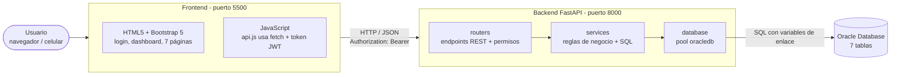

# Arquitectura y decisiones de diseño

## Arquitectura de tres capas

El frontend **nunca** se conecta a Oracle: toda la información viaja por la API REST. El recorrido completo de
un dato es: `Formulario → fetch() → FastAPI (valida y autoriza) → Oracle (persiste y aplica restricciones) → JSON → tabla en pantalla`.

## Capas del backend

| Carpeta | Responsabilidad | Ejemplo |
|---|---|---|
| `routers/` | Define los endpoints, los parámetros de filtro, el código HTTP y qué rol puede usarlos | `POST /api/recolecciones` → 201 |
| `routers/dependencias.py` | Lee el token JWT, verifica que el usuario siga activo y valida el rol | `solo_administrador` |
| `schemas/` | Modelos Pydantic: validan lo que llega (tipos, rangos, formatos) y definen lo que sale | `peso_kg > 0 y ≤ 50.000` |
| `services/` | Reglas de negocio y consultas SQL | "no asignar residuo a una pila finalizada" |
| `models/` | Valores permitidos del dominio (enums), iguales a los `CHECK` de Oracle | `FasePila`, `TipoResiduo` |
| `database/` | Pool de conexiones y funciones `consultar`, `ejecutar`, `insertar` | `oracledb.create_pool(...)` |
| `core/` | Configuración (`.env`), seguridad (bcrypt, JWT) y manejo global de errores | `ORA-00001 → 409` |

## Decisiones de diseño y su justificación

1. **Oracle con el controlador oficial `oracledb` en modo *thin*.** El avance inicial intentaba consultar Oracle
   APEX a través de servicios ORDS ejecutando `curl` desde Python para evadir el firewall de apex.oracle.com; eso
   generaba errores intermitentes (respuestas HTML en lugar de JSON) y no cumplía el requisito de usar `oracledb`.
   Se reemplazó por una conexión directa con `oracledb`, que en modo *thin* no requiere instalar Oracle Client.
2. **Oracle Database Free en Docker.** Permite que cada integrante tenga la misma base de datos con un solo
   comando (`docker compose up -d`). Si se prefiere Oracle XE instalado o Autonomous Database, solo cambia `DB_DSN`.
3. **SQL explícito en lugar de ORM.** Las consultas están escritas en SQL de Oracle (CTE, `FULL OUTER JOIN`,
   `ROW_NUMBER() OVER`, `FETCH FIRST`), lo que permite explicar y probar cada consulta (ver `database/04_queries.sql`).
   Todas usan variables de enlace, por lo que no hay riesgo de inyección SQL.
4. **Pool de conexiones.** Se reutilizan conexiones abiertas en vez de abrir una por petición; cada operación
   hace `COMMIT` si termina bien o `ROLLBACK` si falla.
5. **Validación en tres niveles.** Navegador (HTML5: `required`, `min`, `max`, `pattern`), backend (Pydantic y
   reglas de negocio) y Oracle (`CHECK`, `UNIQUE`, `FK`). Si un nivel falla, el siguiente protege los datos.
6. **JWT sin estado + verificación del usuario.** El token se firma con una clave del `.env` y expira; en cada
   petición se consulta que el usuario siga activo, así desactivar a alguien le quita el acceso inmediatamente.
7. **Roles con código fijo y nombre editable.** Los permisos se verifican con el código interno del rol
   (`ADMINISTRADOR` / `RECOLECTOR`), no con su nombre. Así el administrador puede renombrar un rol o cambiar su
   descripción desde la pantalla de usuarios sin riesgo de quedarse sin acceso. No se pueden crear ni borrar
   roles porque cada uno necesita permisos programados en el backend.
8. **Errores traducidos.** Un manejador global convierte errores de Oracle y de validación en mensajes en
   español con el código HTTP correcto, sin mostrar trazas ni códigos internos al usuario.
9. **Totales calculados, no almacenados.** Kilos por pila, toneladas por mes, rendimiento, etc. se calculan con
   consultas agregadas, para que el dashboard siempre refleje los datos reales.
10. **Frontend sin framework.** HTML, CSS, JavaScript y Bootstrap como pide el enunciado; el código común
   (sesión, `fetch`, mensajes, formularios) está en `auth.js`, `api.js` y `ui.js`, y cada página tiene su script.

## Reglas de negocio implementadas

| Regla | Dónde se valida |
|---|---|
| Un residuo **RECHAZADO** no puede asignarse a una pila | Frontend (deshabilita el campo) + schema Pydantic |
| Clasificación CONDICIONADO o RECHAZADO exige observaciones | Frontend + schema |
| No se registran recolecciones de proveedores **inactivos** | Servicio de recolecciones |
| No se asigna residuo ni se miden pilas **FINALIZADAS** | Servicios de recolecciones y monitoreo |
| Una pila FINALIZADA debe tener fecha de finalización (y no anterior al inicio) | Frontend + schema + `CHECK` |
| Solo se producen lotes de pilas en **MADURACION** o **FINALIZADA** | Servicio de lotes |
| El abono de una pila no puede superar el residuo que recibió | Servicio de lotes |
| El recolector solo edita sus propias recolecciones | Servicio de recolecciones (403) |
| El administrador no puede desactivarse ni eliminarse a sí mismo | Servicio de usuarios |
| Renombrar un rol no cambia permisos (se edita el nombre, no el código interno) | Tabla ROLES (`codigo` fijo) + servicio de usuarios |
| No se eliminan proveedores/usuarios con historial (se desactivan) | FK en Oracle → 409 con mensaje claro |
| Alertas: temperatura > 70 °C o humedad fuera de 40 %–65 % | Servicio de monitoreo, dashboard |

## Indicadores del dashboard

- **Toneladas desviadas de vertederos:** suma del peso de las recolecciones APTAS y CONDICIONADAS (ingresan a compostaje).
- **Kilos de abono producido** y kilos aún **disponibles**.
- **Rendimiento residuo → abono:** abono producido / residuo que ingresó a pilas ya finalizadas (≈ 35 %, valor típico del compostaje).
- Recolecciones y kilos del mes, pilas activas, proveedores activos, pilas por fase y alertas.
