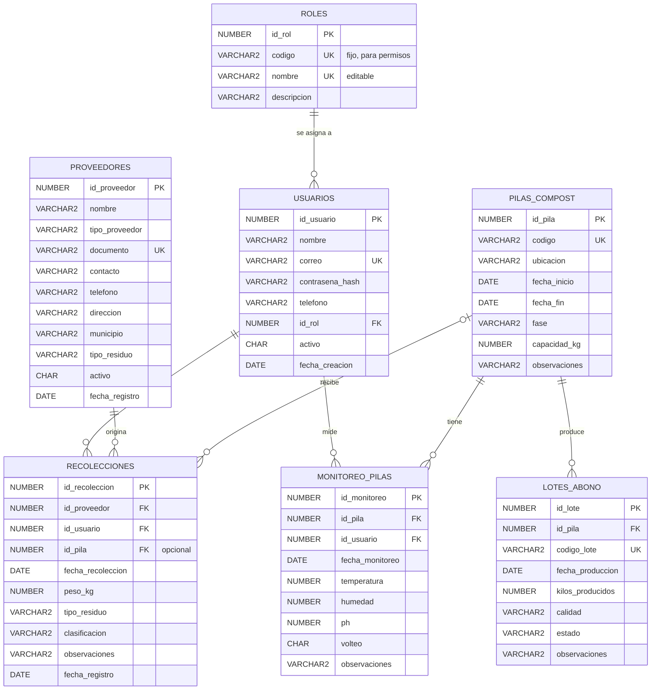

# Modelo de datos — BioCompost

La base de datos se diseñó antes de implementar el backend. Tiene **7 tablas relacionadas** en Oracle Database,
normalizadas hasta tercera forma normal (3FN). Los scripts están en la carpeta [`database/`](../database).

## 1. Modelo entidad-relación

### Relaciones y reglas

| Relación | Cardinalidad | Regla al eliminar el padre |
|---|---|---|
| ROLES → USUARIOS | 1 : N | Bloqueada si el rol tiene usuarios |
| USUARIOS → RECOLECCIONES | 1 : N | Bloqueada (se sugiere desactivar el usuario) |
| USUARIOS → MONITOREO_PILAS | 1 : N | Bloqueada |
| PROVEEDORES → RECOLECCIONES | 1 : N | Bloqueada (se sugiere desactivar el proveedor) |
| PILAS_COMPOST → RECOLECCIONES | 0..1 : N | `ON DELETE SET NULL`: la recolección queda "sin asignar" |
| PILAS_COMPOST → MONITOREO_PILAS | 1 : N | `ON DELETE CASCADE`: las mediciones se borran con la pila |
| PILAS_COMPOST → LOTES_ABONO | 1 : N | Bloqueada: una pila que ya produjo abono no se puede borrar |

**Flujo de trazabilidad:** `PROVEEDORES → RECOLECCIONES → PILAS_COMPOST → LOTES_ABONO`. Gracias a estas
relaciones, de cualquier lote de abono se puede saber de qué pila salió y qué proveedores aportaron el residuo.

## 2. Modelo lógico

Notación: **subrayado = llave primaria**, *cursiva = llave foránea*.

- ROLES (<u>id_rol</u>, codigo, nombre, descripcion)
- USUARIOS (<u>id_usuario</u>, nombre, correo, contrasena_hash, telefono, *id_rol*, activo, fecha_creacion)
- PROVEEDORES (<u>id_proveedor</u>, nombre, tipo_proveedor, documento, contacto, telefono, direccion, municipio, tipo_residuo, activo, fecha_registro)
- PILAS_COMPOST (<u>id_pila</u>, codigo, ubicacion, fecha_inicio, fecha_fin, fase, capacidad_kg, observaciones)
- RECOLECCIONES (<u>id_recoleccion</u>, *id_proveedor*, *id_usuario*, *id_pila*, fecha_recoleccion, peso_kg, tipo_residuo, clasificacion, observaciones, fecha_registro)
- MONITOREO_PILAS (<u>id_monitoreo</u>, *id_pila*, *id_usuario*, fecha_monitoreo, temperatura, humedad, ph, volteo, observaciones)
- LOTES_ABONO (<u>id_lote</u>, *id_pila*, codigo_lote, fecha_produccion, kilos_producidos, calidad, estado, observaciones)

**Normalización (3FN):** cada tabla describe una sola entidad; los datos del proveedor (municipio, contacto) no se
repiten en cada recolección, sino que se obtienen por la llave foránea. Los totales (kilos por pila, abono por
mes, etc.) **no se almacenan**: se calculan con consultas, para que nunca queden desactualizados.

**Decisión de diseño — código y nombre del rol:** cada rol tiene un `codigo` interno fijo (`ADMINISTRADOR`,
`RECOLECTOR`) y un `nombre` visible. Los permisos del backend dependen del código, por eso el administrador puede
cambiar el nombre y la descripción de un rol (por ejemplo, "Jefe de planta") sin que nadie pierda ni gane accesos.

**Decisión de diseño — catálogos como CHECK:** los tipos de residuo, fases y clasificaciones son listas cortas y
estables, por eso se controlan con restricciones `CHECK` en Oracle y con *enums* en el backend
(`backend/models/catalogos.py`), en lugar de tablas adicionales.

## 3. Modelo físico (diccionario de datos)

Llaves primarias con `GENERATED BY DEFAULT ON NULL AS IDENTITY` (Oracle 12c+): el id se genera solo.

### ROLES
| Columna | Tipo | Nulo | Restricciones |
|---|---|---|---|
| id_rol | NUMBER | No | PK, identity |
| codigo | VARCHAR2(30) | No | UNIQUE; CHECK IN ('ADMINISTRADOR','RECOLECTOR'); no se edita |
| nombre | VARCHAR2(50) | No | UNIQUE (`uq_roles_nombre`); editable por el administrador |
| descripcion | VARCHAR2(200) | Sí | Editable por el administrador |

### USUARIOS
| Columna | Tipo | Nulo | Restricciones |
|---|---|---|---|
| id_usuario | NUMBER | No | PK, identity |
| nombre | VARCHAR2(100) | No | |
| correo | VARCHAR2(120) | No | UNIQUE; CHECK formato `%_@_%._%` |
| contrasena_hash | VARCHAR2(100) | No | Hash bcrypt |
| telefono | VARCHAR2(20) | Sí | |
| id_rol | NUMBER | No | FK → ROLES |
| activo | CHAR(1) | No | DEFAULT 'S'; CHECK IN ('S','N') |
| fecha_creacion | DATE | No | DEFAULT SYSDATE |

### PROVEEDORES
| Columna | Tipo | Nulo | Restricciones |
|---|---|---|---|
| id_proveedor | NUMBER | No | PK, identity |
| nombre | VARCHAR2(120) | No | |
| tipo_proveedor | VARCHAR2(20) | No | CHECK IN ('PLAZA_MERCADO','FINCA','AGROINDUSTRIA') |
| documento | VARCHAR2(20) | No | UNIQUE (NIT o cédula) |
| contacto | VARCHAR2(100) | Sí | |
| telefono | VARCHAR2(20) | Sí | |
| direccion | VARCHAR2(200) | No | Punto de recolección |
| municipio | VARCHAR2(60) | No | |
| tipo_residuo | VARCHAR2(20) | No | CHECK IN ('FRUTAS','HORTALIZAS','ESTIERCOL','BAGAZO','MIXTO') |
| activo | CHAR(1) | No | DEFAULT 'S'; CHECK IN ('S','N') |
| fecha_registro | DATE | No | DEFAULT SYSDATE |

### PILAS_COMPOST
| Columna | Tipo | Nulo | Restricciones |
|---|---|---|---|
| id_pila | NUMBER | No | PK, identity |
| codigo | VARCHAR2(20) | No | UNIQUE |
| ubicacion | VARCHAR2(100) | Sí | |
| fecha_inicio | DATE | No | |
| fecha_fin | DATE | Sí | CHECK fecha_fin ≥ fecha_inicio |
| fase | VARCHAR2(20) | No | DEFAULT 'MESOFILICA'; CHECK IN ('MESOFILICA','TERMOFILICA','ENFRIAMIENTO','MADURACION','FINALIZADA') |
| capacidad_kg | NUMBER(10,2) | Sí | CHECK > 0 |
| observaciones | VARCHAR2(400) | Sí | |

### RECOLECCIONES
| Columna | Tipo | Nulo | Restricciones |
|---|---|---|---|
| id_recoleccion | NUMBER | No | PK, identity |
| id_proveedor | NUMBER | No | FK → PROVEEDORES |
| id_usuario | NUMBER | No | FK → USUARIOS (quien registra) |
| id_pila | NUMBER | Sí | FK → PILAS_COMPOST, ON DELETE SET NULL |
| fecha_recoleccion | DATE | No | |
| peso_kg | NUMBER(10,2) | No | CHECK > 0 y ≤ 50.000 |
| tipo_residuo | VARCHAR2(20) | No | CHECK (mismos valores que proveedores) |
| clasificacion | VARCHAR2(20) | No | DEFAULT 'APTO'; CHECK IN ('APTO','CONDICIONADO','RECHAZADO') |
| observaciones | VARCHAR2(400) | Sí | |
| fecha_registro | DATE | No | DEFAULT SYSDATE |

### MONITOREO_PILAS
| Columna | Tipo | Nulo | Restricciones |
|---|---|---|---|
| id_monitoreo | NUMBER | No | PK, identity |
| id_pila | NUMBER | No | FK → PILAS_COMPOST, ON DELETE CASCADE |
| id_usuario | NUMBER | No | FK → USUARIOS |
| fecha_monitoreo | DATE | No | |
| temperatura | NUMBER(5,2) | No | CHECK BETWEEN 0 AND 90 (°C) |
| humedad | NUMBER(5,2) | No | CHECK BETWEEN 0 AND 100 (%) |
| ph | NUMBER(4,2) | Sí | CHECK BETWEEN 0 AND 14 |
| volteo | CHAR(1) | No | DEFAULT 'N'; CHECK IN ('S','N') |
| observaciones | VARCHAR2(400) | Sí | |

### LOTES_ABONO
| Columna | Tipo | Nulo | Restricciones |
|---|---|---|---|
| id_lote | NUMBER | No | PK, identity |
| id_pila | NUMBER | No | FK → PILAS_COMPOST |
| codigo_lote | VARCHAR2(20) | No | UNIQUE |
| fecha_produccion | DATE | No | |
| kilos_producidos | NUMBER(10,2) | No | CHECK > 0 |
| calidad | VARCHAR2(20) | No | DEFAULT 'ESTANDAR'; CHECK IN ('PREMIUM','ESTANDAR','REPROCESO') |
| estado | VARCHAR2(20) | No | DEFAULT 'DISPONIBLE'; CHECK IN ('DISPONIBLE','DESPACHADO') |
| observaciones | VARCHAR2(400) | Sí | |

### Índices

Además de los índices automáticos de PK y UNIQUE, se crean índices sobre las llaves foráneas y los campos más
filtrados: `recolecciones(id_proveedor)`, `recolecciones(id_usuario)`, `recolecciones(id_pila)`,
`recolecciones(fecha_recoleccion)`, `monitoreo_pilas(id_pila, fecha_monitoreo)`, `lotes_abono(id_pila)`,
`pilas_compost(fase)` y `usuarios(id_rol)`.

## 4. Datos iniciales

`03_data.sql` carga un escenario realista de mayo a octubre de 2026 en el Valle del Cauca: 2 roles, 4 usuarios,
8 proveedores (Cali, Palmira, Candelaria, Jamundí, Pradera, Yumbo, El Cerrito y Florida), 6 pilas (una en cada
fase), 48 recolecciones (~40 toneladas), 74 mediciones con curvas de temperatura propias de cada fase y 4 lotes
de abono (6.400 kg, rendimiento ≈ 35 %).
